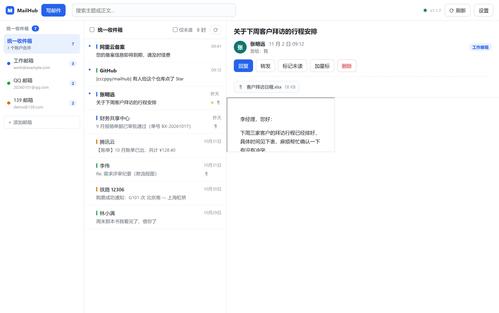
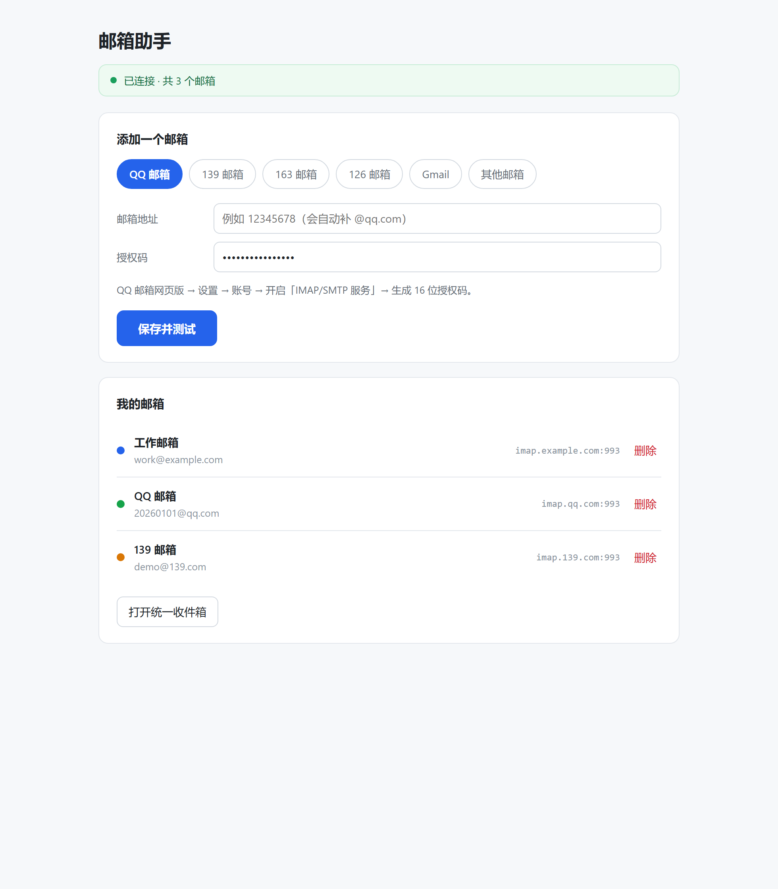
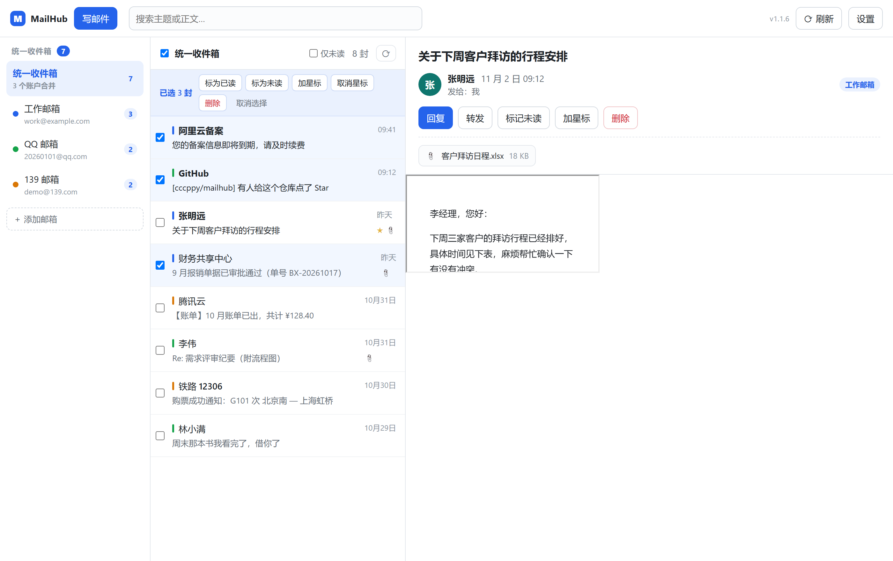
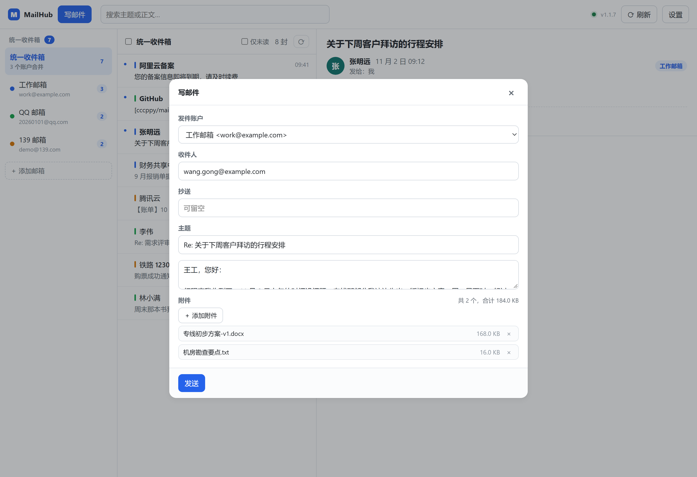

# MailHub · 统一邮箱

把 **QQ 邮箱、139 邮箱（中国移动）、163 / 126 邮箱** 等多个邮箱的邮件聚合到同一个界面里统一收发的浏览器插件（Chrome / Edge）。

左侧是账户与文件夹，中间是合并后的邮件列表，右侧直接读信、回信、发信 —— 不用再在五六个网页标签之间来回切换。



---

## 为什么需要一个本地服务？

这是这个项目最关键的一点，先说清楚：

> **浏览器插件没有能力直接说 IMAP 协议。**

Chrome 插件只能发 HTTP/WebSocket 请求，而收邮件用的 IMAP 是一套基于 TCP 长连接的文本协议。所以插件没法自己连 `imap.qq.com:993`。

必须有一个"翻译层"：它用 IMAP/SMTP 跟各家邮箱对话，再暴露成 HTTP 接口给插件调用。这个翻译层就是 `server/` 目录。

```
┌──────────────┐   HTTP + Bearer Token   ┌─────────────────┐   IMAP/SMTP   ┌──────────┐
│  浏览器插件   │ ──────────────────────► │  MailHub 服务    │ ────────────► │ QQ 邮箱   │
│ (Chrome MV3) │ ◄────────────────────── │ (Node.js, 本机)  │ ◄──────────── │ 139 邮箱  │
└──────────────┘   统一格式的邮件 JSON    └─────────────────┘               │ 163 邮箱  │
                                                                           └──────────┘
```

服务跑在**你自己的电脑上**，授权码用 AES-256-GCM 加密后存在本机 `server/data/` 里，不会上传到任何第三方。

---

## 目录结构

```
email-hub/
├── 启动邮箱助手.bat             ← 平时不用碰它。装机第一步双击一次即可（装依赖 + 注册开机自启）
├── 停止邮箱助手.bat             ← 想彻底关掉服务时双击
├── 取消开机自启.bat             ← 不想让它跟着开机启动时双击
│
├── native/                     让「点图标就能启动」成为可能的启动器
│   ├── daemon.js               守护进程：拉起服务、崩了自动重启、写日志
│   ├── launcher.js             Native Messaging 宿主：插件点图标时被唤起，端口没人听就把服务拉起来
│   ├── launcher.bat            宿主入口（浏览器只能执行单个可执行文件，不能带参数）
│   ├── start-hidden.vbs        无窗口启动服务，开机自启和守护进程都靠它
│   └── com.mailhub.launcher.json  宿主清单（声明只允许本插件调用）
│
├── server/                     本地中转服务（Node.js）
│   ├── .env.example            配置示例，复制成 .env 后可按需修改
│   └── src/
│       ├── index.js            Express 入口、CORS、一键连接、令牌校验、错误处理
│       ├── config.js           读环境变量；首次启动自动生成密钥与访问令牌
│       ├── crypto.js           授权码的 AES-256-GCM 加解密
│       ├── store.js            账户库（JSON 落盘，原子写入）
│       ├── providers.js        各邮箱的 IMAP/SMTP 预设
│       ├── util.js             HttpError / asyncHandler / withTimeout
│       ├── mail/
│       │   ├── imap.js         收信：文件夹、列表、正文、附件、标记、删除、发信副本
│       │   ├── idle.js         实时推送：每账户一条 IMAP IDLE 常驻连接 + SSE 广播
│       │   └── smtp.js         发信：from 强制等于登录账户，附件映射与总量校验
│       └── routes/
│           ├── accounts.js     /api/accounts
│           ├── messages.js     /api/messages
│           ├── events.js       /api/events（SSE 推送流）
│           └── send.js         /api/send
│
├── extension/                  浏览器插件（Manifest V3，无构建步骤）
│   ├── manifest.json
│   ├── icons/                  自动生成的图标
│   └── src/
│       ├── background.js       Service Worker：点击图标开面板、未读角标轮询
│       ├── lib/
│       │   ├── api.js          插件与本地服务之间的唯一出口
│       │   ├── sanitize.js     邮件正文净化（白名单 + sandbox iframe 双保险）
│       │   └── util.js         时间、体积、地址格式化
│       ├── app/                统一收件箱主界面
│       └── options/            设置页
│
├── tools/
│   ├── make-icons.mjs          纯手工生成 PNG 图标（无第三方依赖）
│   ├── write-host.js           按当前文件夹算出宿主清单（绝对路径 + 扩展 ID）
│   ├── gen-shots.mjs           生成下面那些界面截图：套真实的 CSS + 假数据，用 Edge 无头模式截
│   └── gen-bat.py              生成所有 .bat / .vbs / 宿主清单。为什么用 Python：bat 必须 CRLF + GBK，
│                               宿主清单必须 UTF-8 无 BOM，三者要求冲突，只能按字节写
├── docs/screenshots/           README 里的界面图（演示数据，不含真实邮件）
├── .gitattributes
├── .gitignore
├── LICENSE
└── README.md
```

---

## 快速开始

装好之后，日常使用**只有一件事**：点一下浏览器右上角的 MailHub 图标。

> 拿到项目：`git clone https://github.com/cccppy/mailhub.git`，或者页面右上角 **Code → Download ZIP** 解压。
> 放在哪个盘、哪个目录都行，路径不参与任何硬编码 —— 下面第 1 步会按当前目录自动算好。

### 第 1 步：双击一次 `启动邮箱助手.bat`（只做一次）

第一次双击会自动装依赖（大约 1 分钟），同时把后面要用的几样东西一次配好：

- 向 Edge / Chrome 注册 Native Messaging 宿主（这是「点图标自动拉起服务」的前置条件）
- 写注册表 `HKCU\...\CurrentVersion\Run`，并在「启动」文件夹里放一份 `MailHub.vbs`
- 结束后把插件目录路径复制到剪贴板

窗口最后显示 `[OK] 服务已经在运行`，然后自己倒计时 10 秒关掉 —— 关掉不影响服务，它在后台继续跑。

> 这一步做完，以后开机服务自己就在后台跑着，你不用再碰任何 `.bat`。
> 即使服务被意外结束、或者你手动关掉了，**点一下插件图标也会自动把它拉起来** —— 等两三秒就能用。

### 第 2 步：把插件装进浏览器（只做一次）

1. 地址栏输入 `chrome://extensions` 回车（Edge 是 `edge://extensions`）
2. 打开右上角的 **开发者模式**
3. 点左上角 **加载已解压的扩展程序**
4. 在选文件夹的窗口里直接按 `Ctrl+V`，再回车

> 插件目录路径已经由第 1 步的脚本复制到剪贴板了，第 4 步直接粘贴即可。
> 路径就是你解压 / 克隆出来的那个文件夹下的 `extension` 目录，放在哪个盘都行。

装好后点右上角那个蓝色信封图标，收件箱就打开了。

### 第 3 步：加一个邮箱

点插件图标 → 左下角「＋ 添加邮箱」（或者直接在空白页上点「添加第一个邮箱」）：

1. 选品牌：QQ / 139 / 163 / 126
2. 填 **邮箱地址**（只填 `@` 前面那半截也行，会自动补全）
3. 填 **授权码**
4. 点「保存并测试」

就这样，没有第 5 步。服务地址和访问令牌会自动领好，不用你复制粘贴。



加完第一个邮箱会自动跳到收件箱，多个邮箱的邮件已经合并在一起了。

---

## 服务是怎么自己起来的

早先的版本要你每次用之前双击一次 `启动邮箱助手.bat`，太啰嗦。现在改成了三层保险：

```
点一下扩展图标
      │
      ├─► ① 先探 http://127.0.0.1:8787/api/health
      │     有人在听 → 直接开界面，零等待
      │
      └─► ② 没人听 → 通过 Native Messaging 唤起 native/launcher.js
             │
             └─► 端口还是空 → detached 拉起 native/daemon.js
                    │
                    └─► daemon 用 wscript 无窗口启动服务进程
                           └─► 拉起成功，守护进程留在后台盯着
```

**为什么必须绕这一圈？** 浏览器插件被沙箱关着，没有权限启动任何本地进程 —— 这是 `chrome.runtime.connectNative` 存在的唯一理由。所以项目里有一个「宿主清单 + 注册表登记」的死板步骤，必须在本机做一次。

三层保险分别对应三种意外：

| 场景 | 谁兜住 |
| --- | --- |
| 正常用 | 开机自启已经把服务跑着了，点图标就是秒开 |
| 服务被误关 / 崩了 | 点图标 → 宿主 → 守护进程立刻拉起来，两三秒就好 |
| 守护进程也被杀了 | 双击 `启动邮箱助手.bat`，它会重跑一遍全部注册 |

**服务自己也会自愈**：`native/daemon.js` 会盯着服务进程，一旦发现它退出就自动重启（连续崩溃时逐步拉长间隔，最长 20 秒一次，不会疯狂重试烧 CPU）。日志在 `server/data/service.log`，服务跑着的时候这个文件是空的就说明一切正常。

**想彻底关掉**：双击 `停止邮箱助手.bat`。它会先立一个 `stop.flag` 阻止守护进程重启，再结束进程 —— 所以不会出现「刚关掉又被拉起来」的鬼打墙。

**不想让它开机自启**：双击 `取消开机自启.bat`，它会删掉启动项、顺手把服务停掉。以后想恢复就再双击一次 `启动邮箱助手.bat`。

---

## 关于"自动连接"

插件第一次打开时会向 `http://127.0.0.1:8787/api/handshake` 领一个访问令牌，所以你不用手动填。

这个接口有两道闸门：只接受**本机回环**连接；请求若带 `Origin`，则必须是 `chrome-extension://`。恶意网页发起的跨源请求一定会带自己的 `Origin`，所以照样被拒；别的机器也连不上来——能拿到令牌的，本来就有权读 `server/data/token.txt`，所以安全边界没有降低。

> 实测发现 Chrome 插件发出的请求**并不带 `Origin` 头**（无论页面还是后台 service worker）。所以闸门写成「有 Origin 就必须是插件来源，没有 Origin 则只可能是本机程序」——最开始写成「必须带 `chrome-extension://`」，导致插件每次都被 403 拒绝，界面上只显示一句「连不上本地服务」。这个坑已经修掉，服务端会把每次请求的来源记在 `server/data/diag.log`，以后再连不上可以直接看这个文件。

想手动改地址或看令牌，在设置页最下面展开「高级设置」。

---

## 各邮箱的授权码怎么拿

**注意：这里要填的是"授权码 / 客户端密码"，不是你平时登录网页的密码。** 填登录密码会报 `535 Authentication failed`。

| 邮箱 | 路径 |
| --- | --- |
| **QQ 邮箱** | 网页版 → 设置 → 账号 → 找到「IMAP/SMTP 服务」→ 开启 → 生成授权码（16 位字母） |
| **139 邮箱** | 网页版 → 设置 → 账户与安全 → 邮箱协议设置 → 开启 IMAP/SMTP → 生成客户端授权码（需短信验证） |
| **163 / 126 邮箱** | 网页版 → 设置 → POP3/SMTP/IMAP → 开启 IMAP/SMTP 服务 → 新增授权密码 |

三家邮箱的 IMAP/SMTP 参数已经内置在 `server/src/providers.js` 里，选一下类型就自动填好了：

| 邮箱 | IMAP | SMTP |
| --- | --- | --- |
| QQ | imap.qq.com : 993 (SSL) | smtp.qq.com : 465 (SSL) |
| 139 | imap.139.com : 993 (SSL) | smtp.139.com : 465 (SSL) |
| 163 | imap.163.com : 993 (SSL) | smtp.163.com : 465 (SSL) |
| 126 | imap.126.com : 993 (SSL) | smtp.126.com : 465 (SSL) |

---

## 已经能用的功能

- **统一收件箱**：所有账户的收件箱合并成一个按时间倒序的列表，每封邮件左侧的色条标明它来自哪个邮箱
- **按账户 / 按文件夹浏览**：点左侧账户只看这一个邮箱，再点文件夹可以进「已发送」「垃圾邮件」等
- **读信**：正文以 sandbox iframe 渲染。图片分两类对待：**跟着邮件一起寄来的内嵌图自动显示**（不用联网，不存在追踪问题）；**需要联网取的远程图也默认直接显示**，想看就看，不用为每封信点一遍。要防发件人拿图片探"你读没读"，去设置页「邮件里的图片」选「先拦住」，之后正文里的图会变成灰底虚线框标「图片已拦截」，正文顶上带一条说明，想放行点一下「显示远程图片（N）」即可。设置页那个单选框和阅读区那个按钮改的是同一个值，改完立即生效
- **附件**：读信时列出附件名与大小，点击下载；写信时可以「＋ 添加附件」一并发出，改动前后能随时删掉某个，合计 16 MB 以内（超了会在加的时候就说清楚，不用等发送才失败）
- **写 / 回复 / 转发**：可选发件账户；回复自动带 `In-Reply-To` 与 `References`，在对方客户端里能正确串成会话
- **已发送留档**：发信成功后自动把副本 APPEND 进该账户的「已发送」文件夹，附件也在里面
- **新邮件实时推送**：页面开着时，服务端为每个账户挂一条 IMAP `IDLE` 常驻连接，有新邮件就立刻推过来 —— 列表自动刷新、图标角标同步更新，不用等下一轮轮询。顶栏那个小绿点亮着表示推送正常，断开时变灰并在提示里说明是哪个账户掉了；断了会自己按 3s→60s 退避重连。页面关掉就全断，不白占邮箱服务器的并发连接配额
- **标记**：已读 / 未读 / 星标
- **删除进回收站，可以捡回来**：点删除是**移入该邮箱的「已删除」文件夹**，不是直接抹掉。想彻底清掉就在「已删除」里再删一次（那才是真删）
- **批量管理**：列表左侧可以勾选邮件，支持 Shift 连选一段、`Ctrl+A` 全选（光标在输入框里时不会抢）、`Esc` 取消。选中后底部会浮出一条操作栏，可以一次对几十封改已读 / 未读 / 加星 / 取消星 / 删除
- **搜索**：在收件箱里按关键词搜主题和正文（走服务端 IMAP SEARCH）
- **未读角标**：插件图标上显示汇总未读数，平时每 5 分钟刷新一次，收到实时推送时立刻更新

| 勾选后浮出批量操作栏 | 写邮件 |
| :---: | :---: |
|  |  |

### 实时推送是怎么做的

IMAP 有个 `IDLE` 命令（RFC 2177）：发出去之后连接挂着不返回，服务器有新邮件时主动往下推一行 `* N EXISTS`。用它才能做到秒级提醒，否则只能像以前那样定时轮询。

关键点在于**它是"服务器主动推"**，不是对某条命令的应答。所以不能沿用项目里其它地方那种「连上 → 干活 → logout」的短连接——那样连接根本活不到邮件来的那一刻。现在每个账户维持一条常驻连接，页面一打开就连，页面关掉就全断（QQ/163 对同账号的并发连接是有配额的，没必要在后台白占）。

实现上踩到的几件事，都写进 `server/src/mail/idle.js` 的文件头了，这里说结论：

- **不要手动调 `idle()`**。imapflow 源码注释写得很直白：手动 `idle()` 之后它会一直挂着，**新邮件到达也不会返回**，得从外面再发一条命令才解得开。正确做法是依赖它默认开启的 auto-IDLE（连上并在 `mailboxOpen('INBOX')` 之后自动进入），只监听 `client.on('exists')`。实测的 IMAP 命令序列就是 `SELECT INBOX` → `IDLE` →（收到推送）→ `DONE` → `FETCH 4:4` → `IDLE`，处理完自己挂回去。
- **`'error'` 必须有人接**。ImapFlow 是 EventEmitter，`'error'` 事件没有监听器会被 Node 直接抛成未捕获异常，整个服务进程跟着崩。一个账户连不上就拖垮整个服务，这个代价太大了。
- **imapflow 自己不做重连**。官方文档原话：连接关闭后必须自己新建一个。所以这里自己写了退避重连，3 秒起步翻倍到 60 秒封顶，连上就清零。
- **只取增量，不重扫**。`exists` 事件的载荷是 `{ count, prevCount }`，新邮件永远是 `prevCount+1 .. count` 这一段，只 `FETCH` 这一段就够了。一次最多取 20 封，防止首次同步或批量归档时一口气拉几百个标题。
- **每 8 分钟主动重来一次 IDLE**。RFC 2177 建议别把 IDLE 挂满 29 分钟，不少服务器会悄悄切掉超时连接；重来一次的代价只是一次 `DONE` + `IDLE` 往返，比"偶发断连"便宜得多。

推给浏览器的通道用的是 SSE 而不是 WebSocket：架构本来就是纯 HTTP + 一条本地回环连接，SSE 不用加依赖、浏览器自带重连语义、还能复用同一个 `Authorization: Bearer` 头。但**没有用原生 `EventSource`**——它不支持自定义请求头，令牌只能塞进 URL，而服务端会把请求 URL 原样写进 `data/diag.log`，等于往日志里抄一份密码。改成 `fetch` + `response.body.getReader()` 手工拆 SSE 帧（`\r\n` 归一、`\n\n` 分帧、`:` 开头的是心跳注释），顺带自己实现了退避重连。

### 关于删除的两级语义

不同邮箱的「回收站」叫法不一样（QQ 是 `Deleted Messages`，139 是 `已删除`，163 是 `已删除`），代码靠 IMAP 的 `\Trash` special-use 标记认路，认不出来再按名字猜。实际行为分三种：

| 情形 | 行为 |
| --- | --- |
| 邮件在某文件夹，该邮箱**有**回收站 | IMAP `MOVE` 搬进回收站，之后在「已删除」里能找到 |
| 邮件**已经**在回收站里 | 这时候再删才是真删：打 `\Deleted` 标记 + `EXPUNGE` |
| 该邮箱**没有**回收站（极少数） | 只打 `\Deleted` 标记，不 `EXPUNGE`，邮件不会消失 |

> 早先版本用的是 `messageDelete()`，它内部直接 `EXPUNGE`，所以点一下邮件就没了 —— 这是「为什么删除直接删掉了」的原因，现在已改成上面的分支。

批量操作是按「账户 + 文件夹」分组的：勾 40 封同一文件夹的邮件，服务端只开一次 IMAP 连接、发一条 `STORE`/`MOVE`，不会变成 40 次握手。一次最多 500 封。

### 关于邮件里的图片

邮件正文里的图有两种来路，能不能显示、要不要拦，规则完全不同：

| 类型 | 正文里长什么样 | 图在哪 | 默认行为 |
| --- | --- | --- | --- |
| 内嵌图 | `src="cid:logo@abc"` | 就在这封邮件里，是邮件的一个 MIME part | **直接显示**。它不联网，也就不存在被追踪的问题 |
| 远程图 | `src="https://host/x.png"`、`src="//host/x.png"`、懒加载的 `data-src` / `srcset` | 在发件人的服务器上 | **直接显示**。放行 = 一次带 `Referer` 和你的 IP 的 GET，等于告诉发件人「这个地址有人读过」；不想这样就自己去设置里关掉 |

`cid:` 那种，浏览器本身不认识这个协议，必须先把 Content-ID 对应的 part 取出来转成 `data:` URL 才能显示。这一步服务端做（`mailparser` 解析时已经顺手换好了），前端 `sanitize.js` 里还留了一层兜底，万一正文里还剩 `cid:` 就自己按映射再换一次。

**怎么看待图片这件事**：1.1.2 到 1.1.4 一路默认「先拦后放」，理由是防已读追踪——听着很正当，但代价是每封营销邮件、账单邮件打开都是一排「图片已拦截」的灰框，用户要自己去找那个开关。这不是保护，是添乱。所以 1.1.5 把默认翻过来了：**先给你看图，想防追踪的人自己去设置里关**。

开关只有一个，在设置页「邮件里的图片」里，两档：`全部直接显示`（默认）/ `先拦住，需要时再点开`。阅读区那个按钮和它是同一个值——点一下「隐藏远程图片」，等于把它改成拦；点一下「显示远程图片（N）」，等于改回放行。改完立刻对当前邮件生效，也立刻对以后的邮件生效。

**为什么以前"图片都加载不出来"**：一是占位图用的是 1×1 透明 GIF，被拦掉的图在界面上就是一小片空白，和"这封邮件本来就没图"长得一模一样；二是每打开一封信就把放行开关重置回关闭，等于每封都要重新点一次，实际用起来跟永远不放行没区别。现在占位图是 240×56 的虚线框（写着「图片已拦截」），正文顶部有提示条，开关存进 `chrome.storage.local`（键 `imageMode`，值 `allow` / `block`），一处改全局生效。

> 内嵌图不再出现在「附件」栏里 —— 它是正文的一部分，列出来只会让人以为要下载。判定规则是「有 Content-ID + 是图片 + `Content-Disposition` 不是 attachment」。

---

## 服务端接口一览

所有 `/api/*`（除 `/api/health` 和 `/api/handshake`）都需要请求头 `Authorization: Bearer <访问令牌>`。

| 方法 | 路径 | 说明 |
| --- | --- | --- |
| GET | `/api/health` | 健康检查，不需要令牌 |
| GET | `/api/handshake` | 一键连接：把令牌发给插件页面。限本机回环；带 `Origin` 时必须是 `chrome-extension://` |
| GET | `/api/accounts` | 账户列表 + 内置邮箱预设 |
| POST | `/api/accounts/test` | 只测试连接，不保存 |
| POST | `/api/accounts` | 测试通过后保存账户（授权码加密入库） |
| PATCH | `/api/accounts/:id` | 改显示名称 / 颜色 |
| DELETE | `/api/accounts/:id` | 删除账户 |
| GET | `/api/messages/folders?accountId=` | 文件夹列表（带未读数） |
| GET | `/api/messages` | 邮件列表。**不传 accountId 就是统一收件箱**；支持 `mailbox` / `limit` / `offset` / `unread=1` / `q` |
| GET | `/api/messages/detail` | 单封邮件全文（`accountId` / `mailbox` / `uid`）。返回里的 `inlineImages` 是 `Content-ID -> data: URL`，供正文 `cid:` 引用兜底；`attachments[].inline` 标出哪些是正文内嵌图 |
| GET | `/api/messages/attachment` | 下载附件（`accountId` / `mailbox` / `uid` / `index`） |
| POST | `/api/messages/flags` | 改已读 / 星标（单封） |
| POST | `/api/messages/bulk` | 批量操作。body `{ action, items: [{ accountId, mailbox, uid }] }`，`action` ∈ `read` / `unread` / `flag` / `unflag` / `trash` / `delete`；一次最多 500 封 |
| DELETE | `/api/messages` | 单封删除。**语义是「移入已删除」**，不是物理删除 |
| POST | `/api/messages/purge` | 永久删除。只用于「邮件已经在回收站里」的场景 |
| GET | `/api/messages/unread` | 各账户未读数汇总（角标用） |
| POST | `/api/send` | 发信。body 可带 `attachments: [{ filename, contentType, contentBase64 }]`，合计上限 16 MB |
| GET | `/api/events` | **SSE 实时推送流**。一直挂着不返回，事件见下 |

`/api/events` 会推两种事件：

| 事件 | 载荷 | 什么时候来 |
| --- | --- | --- |
| `status` | `{ accounts: [{ accountId, label, state, error }] }`，`state` ∈ `pending` / `connecting` / `live` / `error` | 订阅时、每个账户连上或断开时 |
| `mail` | `{ accountId, accountLabel, accountColor, count, messages: [...] }` | 有新邮件到达时。`messages` 是这次新增的那几封，字段与邮件列表接口一致 |

令牌走 `Authorization` 头，不在 URL 上 —— 服务端会把请求 URL 原样记进诊断日志，令牌塞进查询串就等于往日志里抄了一份密码。也因此前端没有用原生 `EventSource`（它不支持自定义请求头），改用 `fetch` 读 `response.body` 自己拆 SSE 帧。

---

## 安全说明

- 服务默认只监听 `127.0.0.1`，外网访问不到
- 所有业务接口都要 Bearer 令牌，令牌在首次启动时随机生成
- 一键连接接口（`/api/handshake`）有三重限制：本机回环、带 `Origin` 时必须是 `chrome-extension://`、令牌本身仍在磁盘上——能拿到它的本来就有权读 `data/token.txt`，安全边界没有降低
- 每次 API 请求的来源（Origin / IP / UA）都会追加到 `server/data/diag.log`（超过 256KB 自动只留最近 200 行），方便排查连接问题
- 授权码用 AES-256-GCM 加密后落盘，密钥在 `server/data/secret.key`（权限 600）
- 邮件正文经过两道处理：白名单净化（删掉 `script`/`iframe`/所有 `on*` 事件/`javascript:` 协议），再塞进 `sandbox` 的 iframe —— 即使有漏网的脚本也执行不了
- `.env`、`data/`、`node_modules/` 都不该提交到版本库

**关于令牌出现在 URL 里**：只有下载附件这一处，为了能显示下载进度需要走 `fetch` 拿 Blob，所以其实也是走请求头的。如果你要把服务暴露到局域网（改 `HOST=0.0.0.0`），请务必同时收紧 `ALLOWED_ORIGINS` 并把令牌换成一个长随机串。

---

## 排错

| 现象 | 原因 / 办法 |
| --- | --- |
| 插件显示"连不上本地 MailHub 服务" | 服务没起来。正常情况下点一下插件图标就会自动拉起它，等两三秒即可。一直是这个提示就双击一次 `启动邮箱助手.bat`（那会重新装一遍自启和宿主注册） |
| 插件显示"本地服务没连上" | 同上。仍不行就看 `server/data/service.log`，里面有每一次启动/退出的时间与退出码 |
| 点图标没反应，服务也没起来 | 多半是 Native Messaging 宿主没注册（换过浏览器、重装过插件、或插件 ID 变了）。双击 `启动邮箱助手.bat` 重跑一次注册 |
| 开机后第一次点图标要等几秒 | 正常。开机自启可能还没把服务拉完；点图标会自动催一把，稍等即可 |
| 服务老是崩了又重启 | 看 `server/data/service.log` 里的退出码。连续崩溃时守护进程会拉长重试间隔，不会无限刷 |
| 想让服务彻底停下来别再自己起 | 双击 `停止邮箱助手.bat`，它会先立停止标记再杀进程 |
| 双击启动脚本窗口一闪就没了 | 可能端口 8787 已被占用（服务本来就在跑），脚本会直接跳过启动。看窗口里打印的最后一行即可 |
| 点了删除，邮件去哪了 | 进了「已删除」文件夹（左侧账户下面的子文件夹里）。想彻底清掉就在那儿再删一次 |
| 勾选框看不见 | 鼠标移到邮件行上，左侧圆点会变成方框；勾上之后一直显示。顶栏版本号不是 `v1.1.8` 就是插件没重新加载 |
| 加附件时提示"合计会超过 16 MB" | 这是服务端同一套限额，加的时候就说清楚，不用等发送才失败。减几个大的，或者把文件放网盘、正文里发链接。上限来自 `server/src/mail/smtp.js` 的 `ATTACH_TOTAL_MAX`，请求体本身受 `express.json` 的 25 MB 限制（base64 会膨胀 4/3），所以卡在 16 MB |
| 附件发出去了，但「已发送」里那份没带附件或根本没有 | 1.1.7 修掉了。旧代码靠 `info.message` 取原始报文，而 nodemailer 的 SMTP 传输从不设置这个字段，所以存档那一步一直静默跳过。现在改成发送前自己用 `MailComposer` 编译一份，附件自然在里面。顶栏版本号还是旧的就去 `edge://extensions` 重新加载一次 |
| 提示"访问令牌无效" | 令牌过期或换了数据目录。点插件右上角「重新连接」，会自动重新领取 |
| 添加账户报 `535 Authentication failed` | 用了网页登录密码。必须用邮箱后台生成的**授权码** |
| 添加账户报 `Unsafe Login`（163 常见） | 服务端已通过发送 IMAP `ID` 命令处理；若仍报错，确认 163 后台「IMAP/SMTP 服务」已开启 |
| 连接超时 | 139/163/QQ 的 993 端口被网络或公司防火墙挡了；换个网络试试 |
| 列表里某个账户报错但其他正常 | 这是设计如此：单账户失败不影响其他账户，错误会显示在列表上方 |
| 双击启动脚本窗口一闪就没了 | 说明端口 8787 已被占用，服务可能本来就在跑；直接点插件图标试 |
| 顶栏那颗绿点不亮（或变灰） | 它是实时推送的连接状态：绿 = 已连上，灰 = 某个账户断开或正在重连。灰的时候鼠标悬上去会写明是哪个账户、什么原因。常见原因是该邮箱的 IMAP 并发连接被别的客户端占满了，等退避重连即可；服务没起来时它干脆不显示 |
| 有新邮件但界面没动静 | 先看绿点在不在。绿点亮着还收不到，检查是不是在「统一收件箱」以外的视图：推送只在收件箱列表上触发自动刷新，切到别的文件夹或搜索状态下只弹提示不打断你。另外页面关掉期间不会有推送，那段时间靠角标轮询发现 |
| 图标角标不更新 | 平时每 5 分钟轮询一次；收到实时推送时会立刻更新。点一下插件图标打开面板也会立刻刷新 |
| 点开邮件右侧"正文一片空白" | 已经被三个不同原因各咬过一次，现在都修了。1.1.2：正文区改成绝对定位的 iframe 铺满容器，不再依赖 flex/百分比高度层层继承。1.1.6：拆掉一层帮倒忙的兜底——那层「2.2 秒还没渲染好就退化成纯文本」的看门狗，会把已经渲染好、但图还没加载完的正文整个藏起来。1.1.8：**窗口拖小/变窄时**，上面标题栏（长标题换行 + 六个操作按钮折行 + 附件）会把下面 `flex:1` 的正文区压成 0 高度，正文其实已经写进 iframe 了，只是没有高度可以显示。现在标题栏空间不够时自己收缩、自己滚动，正文区保底 160px，同时窄窗口下侧栏和列表主动让位给正文。**顶栏右侧会显示版本号**，看不到 `v1.1.8` 就说明扩展没重新加载 |
| 正文里的图显示成灰色虚线框，写着「图片已拦截」 | 1.1.5 起默认**不再拦**，正常情况下不该再看到这个。如果还看到：顶栏版本号是不是 `v1.1.8`（低于 v1.1.5 的版本就是会拦）；或者你去设置页「邮件里的图片」里选过「先拦住」。想看图，点阅读区那个黄色的「显示远程图片（N）」按钮，一下全出来，以后都不用再点 |
| 点了「显示远程图片」还是空 | 先看提示条和占位框是不是还在：还在就是没点到（或者扩展没重新加载，顶栏不是 `v1.1.8`）。占位框消失、位置还是空，那就是图床本身挂了或被网络挡了 —— 这种情况原邮件在网页版里也显示不出来 |
| 有图但显示成一个小方块/一根细线 | 那是图片自带的尺寸太小（营销邮件里的分隔线、埋点像素），不是加载失败 |
| 点了 139 却显示 QQ 的邮件 | 1.1.2 已修。旧代码里有一个"正在加载就丢弃新请求"的布尔锁，切账户时新请求被直接扔掉；现在按请求序号只认最后一次，切走的旧回包一律丢弃。切换瞬间列表会先变成骨架占位，不会残留上一个邮箱的邮件 |
| 想立刻拉一下最新邮件 | 顶栏「刷新」按钮、列表标题右边的 `⟳`、以及 F5 都可以。刷新中按钮会转圈并显示"刷新中…"，完成后提示共拉到几封 |
| 切换邮箱要等好几秒才有列表 | 正常现象：每次切账户都要向对应邮箱服务器重新发一次 IMAP 请求，实测 139 约 5 秒、QQ 约 1 秒。等待期间列表显示骨架条，标题已经是新账户的名字 |

---

## 更新记录

- **1.1.8** — 修 1.1.7 之后又冒出来的「正文一片空白」。这次跟前两次（1.1.2 高度算错、1.1.6 定时器帮倒忙）不是同一个病，是**阅读区被上面的标题栏挤没了**。
  ① 定位过程：同一个窗口尺寸换成小号就能稳定复现。1400×900 时正文区 591px 正常；900×560 时正文区 `0`，而 iframe 里的正文文档有 1483 字节、正文元素本身 448px 高 —— 正文**写进去了**，是容器没有高度。窗口越窄，标题换行、`meta` 换行、六个操作按钮折成两三行、附件栏再叠一层，`.reader-head` 的总高能到四五百像素（实测 900×560 时 473px，比整个阅读区还高），而它原来是 `flex: none`（绝不收缩），于是 `flex: 1` 的正文区被一路压到 0。`#r-frame` 的 `position: absolute; inset: 0` 只能跟随父容器，父容器是 0 它也是 0。
  ② 改法：`.reader-head` 改成 `flex: 0 1 auto` + `min-height: 0` + `overflow-y: auto` —— 空间不够时自己缩、自己滚，不再抢正文的地盘。`.reader-body` 加 `min-height: 160px` 作为最后一道保底。
  ③ 顺带让窄窗口可用：三列原本是死宽度（236px / 最多 400px / 剩余），900px 窗口里正文只剩 238px 宽，一屏字挤成一小条。加了两档媒体查询，≤1180px 收窄侧栏与列表，≤940px 再收一档，把宽度让给正文（同尺寸下正文宽度 238px → 438px）。侧栏没有整个藏起来——账号列表在里面，藏了就没法切账户。
  ④ 实测（真实扩展环境 + 真实邮件 + 最坏情况的标题栏）：900×560 从 `body=0 / frame=0` 变成 `body=160 / frame=160`；820×520、760×480 同样从 0 变成 160；1400×900 保持 591 不变。
- **1.1.7** — 两个功能 + 一个顺带修掉的旧 bug。
  ① **新邮件实时推送**。服务端新增 `mail/idle.js`，每个账户一条 IMAP `IDLE` 常驻连接，靠 `'exists'` 事件感知新邮件，只 `FETCH` 新增那一段（`prevCount+1 .. count`）后经 SSE 推给页面；页面收到就刷新列表、更新角标。连接断了按 3s→60s 退避重连，每 8 分钟主动重来一次 `IDLE` 防服务器侧悄悄切断。页面关掉即全断。顶栏加了一颗绿点显示连接状态。细节见上面「实时推送是怎么做的」。
  ② **写信加附件**。服务端 `smtp.js` 补上 `attachments` 的映射与总量校验（16 MB，留出 `express.json` 25 MB 与各家 SMTP 单封上限的余量），前端加「＋ 添加附件」并能逐个移除，读成 base64 传上去。实测抓到的 MIME 是 `multipart/mixed`，中文文件名按 RFC 2231 折行编码，正文与附件各自 base64。
  ③ **修「已发送」副本其实从来没写成**。原实现取 `info.message` 来编译原始报文，可 nodemailer 的 SMTP 传输只设置 `info.messageId`、**从不设置 `info.message`**，于是那句 `info.message ? ... : null` 恒为 `null`，`routes/send.js` 里的 `if (result.raw)` 永远为假。不报错、不报警，静默失效。改成发送前用 `MailComposer` 自己编译一份，并把编译出来的 `Message-ID` 回填给要发的那封，两边对得上号。实测存档件与线上报文的 `Message-ID` 完全一致。
- **1.1.6** — 修 1.1.5 带出来的「正文一片空白」。
  ① 根因：1.1.2 留下的那个「2.2 秒看门狗」，判据是 `srcdoc` 的 `load` 事件没来就铺纯文本、把 iframe 藏起来。可 `load` 要等**所有子资源**加载完——1.1.5 放开远程图之后，一封营销邮件几十张外部图里只要有一张慢或被墙，`load` 就迟到，定时器反而先到，把早就渲染好的正文整个藏掉。
  ② 定时器的判据本身就不成立：「图还没加载完」是最正常的情况，跟「渲染失败」不是一回事；1.1.2 那次白板的真实原因（iframe 高度层层继承失败）早已由 `#r-frame` 的绝对定位根治，不需要再拿定时器兜。
  ③ 顺着拆干净：定时器、`showFallback()`、`stripTags()`、`#r-fallback` 那段 DOM 与样式全部移除。留着一段永不执行的「兜底」比没有更糟——看代码的人会以为白板还有第二道保险。
  ④ 正文真出状况时，顶栏与列表头的「刷新」仍可重新拉取重绘。
- **1.1.5** — 把 1.1.4 的判断翻过来：**邮件图片默认直接显示**。1.1.4 默认「先拦后放」，结果是每封带图的邮件打开都是一整屏「图片已拦截」的灰框，用户还得自己去找开关——防追踪防到这个份上，已经不是保护而是添乱。
  ① 默认改为放行（`imageMode` 未设置时按 `allow` 处理），邮件打开就是完整图文。
  ② 设置页新增「邮件里的图片」一整块，两档单选：`全部直接显示`（默认）/ `先拦住，需要时再点开`，选中即写入 `chrome.storage.local`，不用重开收件箱。
  ③ 阅读区那个按钮改成同一份数据的另一个入口，并且互相联动：`storage.onChanged` 监听，设置页改完这边开着的阅读区立刻跟着变；按钮在「有图被拦着」时变成琥珀色加粗，不再混在回复/转发里当隐形人。
  ④ 换掉旧的布尔键 `showRemoteImages`（语义被老逻辑污染过，里面可能躺着一个不该算数的 `false`），改用 `imageMode: 'allow' | 'block'`。
  ⑤ 提示条文案改成「点正文上方」并说明一次点开长期有效，不再指错方向。
- **1.1.4** — 修「邮件里的图片都加载不出来」。根因是两条：占位图原来是 1×1 透明 GIF，"被拦"和"没图"在界面上完全分不出来；放行开关每打开一封信就重置，等于永远放行不了。现在：
  ① 占位图换成 240×56 的虚线框，写明「图片已拦截」；正文顶部加一条提示，带上被拦的张数与操作指引。
  ② 「显示远程图片」按钮带上张数（`显示远程图片（29）`），点一次即放行，并且**记住这个选择**（`chrome.storage.local`），后续邮件不用再点；按钮同时变成「隐藏远程图片」可随时收回。
  ③ 补齐 `cid:` 内嵌图的处理（服务端 `mailparser` 内联 + 前端 `resolveCidImages` 兜底），转发邮件、带截图的邮件里的图现在能显示。
  ④ 拦截判定补上协议相对地址（`//host/x.png`）和 `data-src` / `data-original` / `data-lazy-src` / `srcset` 懒加载写法，以前这几类会漏拦、且拦了也没有占位。
  ⑤ 内嵌图不再混进「附件」栏。
  实测（真实邮件，139 收件箱 35 个 ``、29 张远程图）：默认状态 29 张全部换成占位、0 个图片请求、提示条显示「已拦截 29 张」；点放行后 29 张全部解码成功。
- **1.1.3** — 三件事：
  ① **点图标即用**。新增 `native/` 启动器（守护进程 + Native Messaging 宿主），插件点图标时若发现服务没在跑会自动拉起；配注册表 Run 键与「启动」文件夹双保险实现开机自启，服务崩了守护进程会自动重启。不再需要每次双击 bat。
  ② **删除改为移入「已删除」**。原来用的 `messageDelete()` 内部直接 `EXPUNGE`，点一下就物理消失；现在按 `\Trash` 标记定位回收站并 `MOVE` 进去，只有在回收站里再删才是真删。
  ③ **批量管理**。列表支持勾选 / Shift 连选 / `Ctrl+A` 全选 / `Esc` 取消，底部浮现操作栏，可批量改已读、加星、删除。服务端新增 `/api/messages/bulk`，按「账户 + 文件夹」分组，一组只开一次 IMAP 连接。
- **1.1.2** — 正文区改为绝对定位铺满，修掉"点开邮件正文一片空白"；新增渲染看门狗与纯文本兜底（后者在 1.1.6 已移除，见上）；列表请求改为按序号只认最后一次，修掉"切了账户还显示上一个邮箱的邮件"；新增刷新按钮（顶栏 + 列表头 + F5）与骨架占位；顶栏显示版本号
- **1.1.1** — 修掉整页高度被邮件列表撑开导致的错位
- **1.1.0** — 多账户聚合收件箱、文件夹切换、写信/回复/转发、附件下载、远程图片拦截

---

## 已知限制

这些是当前版本的取舍，不是 bug：

- **下载附件会重新拉取整封邮件**。IMAP 的 `BODY[part]` 按需取块会更高效，留作后续优化
- **只聚合收件箱**。多账户合并目前仅对 `INBOX` 生效，其他文件夹需要切到具体账户看
- **发信是纯文本**。写邮件框是纯文本，不支持富文本编辑器（附件已支持）
- **实时推送只在页面开着时有效**。插件页面关掉后常驻连接会断开，那段时间的新邮件靠角标那 5 分钟一次的轮询发现。要做后台常驻推送得把连接放进 Service Worker 或者原生守护进程，留给后续
- **搜索是服务端 IMAP SEARCH**，依赖邮箱服务器自己实现的搜索能力，语义上不如本地建索引精确
- **批量操作有 500 封上限**。再多就得分批 —— 不是技术做不到，是一次 `STORE` 塞几千个 uid 时各家服务器的容忍度差别很大，容易整条命令被拒
- **未打包扩展的 ID 跟着文件夹路径走**。ID 是由扩展目录的绝对路径算出来的，所以把项目挪到别的盘、或者换台电脑，ID 都会变。这一点已经处理掉了：`启动邮箱助手.bat` 每次运行都会调 `tools/write-host.js` 按当前位置重算宿主清单（绝对路径 + 扩展 ID），**搬完双击一次就自动修好**，不用手改任何 JSON。搬完之后记得在 `chrome://extensions` 里重新加载一次扩展
- **只支持 Windows**。`native/` 里的启动器是 bat + VBS，macOS / Linux 得另写一套（原理一样，换成 shell 脚本 + LaunchAgent / systemd user unit）

---

## 后续可以做的

1. 后台常驻的实时推送（把 IDLE 连接挪进 Service Worker 或原生守护进程，页面关着也能收）
2. 富文本编辑器 + HTML 发信
3. 多账户的"已发送 / 垃圾邮件"也做合并视图
4. 本地 SQLite 缓存 + 离线可读 + 本地全文索引
5. 联系人自动补全（从历史收发件人里学）
6. 批量操作加上「移动到指定文件夹」（`/api/messages/bulk` 目前只支持标记与删除）
7. 附件上传走分片或流式，摆脱 16 MB 这个总量上限
8. 打包成桌面端（Tauri / Electron），把「装插件 + 注册宿主」这两步也省掉

---

## 许可

MIT License，见 [LICENSE](LICENSE)。可以随意使用、修改、分发，商用也行，保留版权声明即可。

需要说明的是：这个项目直接操作你的邮箱凭据，所以请自己看一眼源码再用 —— 授权码用 AES-256-GCM 加密后只存在你本机的 `server/data/` 里，出网的只有发往各个邮箱服务器的 IMAP/SMTP 流量，没有任何遥测和第三方服务。仓库里不含任何账户数据（`server/data/` 已在 `.gitignore` 中）。
